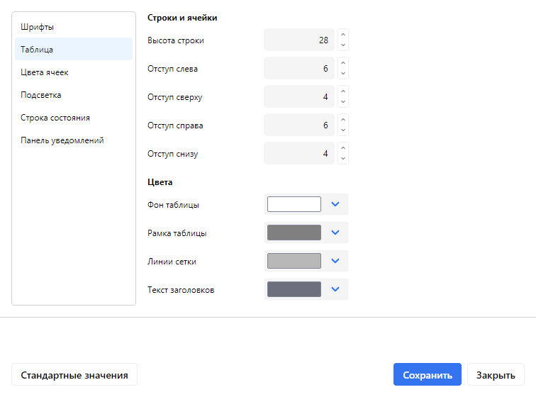

# Grid Style Configuration

## Overview

Every recipe-grid and app-chrome style flows from one YAML file per equipment config:
`{configDir}/ui/grid_style.yaml`. No style is hardcoded in the UI — fonts, paddings, row height,
cell/execution/selection palettes, status-bar and validation-panel chrome, the main-window
border/background/header colors, and the grid's default orientation all come from that file. An in-app editor edits the same file; the
operator does not hand-edit YAML. Changes apply on the next restart.

This file is the styling counterpart of `recipe-grid-column-sizing.md`: the sizing doc explains how a
column's width is computed; this one explains where the style values (including the font sizes that
feed that computation) come from and how they reach the screen.

## Visual theme vs config palette (the theming contract)

The app chrome (buttons, scrollbars, inputs, window surfaces) is themed by **Semi.Avalonia**, retinted
toward JetBrains/IntelliJ "New UI" tokens, **Light variant only**. The retint overrides Semi's
component keys (`TextBoxForeground`, `ButtonSolidPrimaryBackground`, `CheckBoxCheckedDefaultBackground`,
`MenuItemForeground` and others) in the `Light` theme dictionary in
`App.axaml`, plus the `*CornerRadius` component keys and the static tokens in `Styles/ColorPalette.axaml`.
The interactive controls get a corner radius of 4. `DataGridRowCornerRadius` is 0, which removes the
row pointer-over halo.

Semi's control themes read the component keys with `DynamicResource`, so an override in `App.axaml`
reaches the control. Semi's component keys alias the `SemiColor*` primitives with `StaticResource` inside
Semi's own dictionaries, so an app override of a primitive does not reach a Semi control. The
exception is a separate Semi theme assembly that aliases a primitive without defining it: the
DataGrid theme and the ColorPicker theme resolve such a primitive from the app. Four primitives stay
in the `Light` dictionary. `SemiColorText0`, `SemiColorText2` and `SemiColorBorder` stay because
SemiStep's own setters and the DataGrid theme read them. `SemiColorPrimary` stays because the
ColorPicker theme reads it for the selected tab and the RGB/HSV switch in the color picker flyout.

`ThemeTests` (`SemiStep.Tests/UI/Styles/ThemeTests.cs`) guards the chrome color keys of text, windows,
buttons, checkboxes, text boxes and menus, and the `SemiColorPrimary` accent of the color view. It
realises each control and reads the painted brush back for each state, so a Semi update that stops
reading a key fails the test instead of changing the look. The
`DataGrid*` and `*CornerRadius` keys have no theme test.

The UI font is the native system Segoe UI (set via `ChromeFontFamily` in `Styles/ColorPalette.axaml`);
the grid uses that same Segoe family with OpenType tabular figures (`+tnum`) so digit columns align
without a monospaced font. There are no embedded fonts (no `Assets/Fonts`).

The boundary between that fixed theme and per-equipment config is exact: **the resources
`CellPaletteInstaller` pushes from `grid_style.yaml`** (listed in "Resources projection" below) are the
config-driven palette — the cell palette, the focus frame, status bar, and app chrome. Everything else
is the Semi-plus-overrides theme. Together those two — the installer resources and the Semi
semantic-token overrides in `App.axaml` — are the theming contract: a config file restyles the
grid/chrome palette through the installer without touching the base theme, and the base theme governs
every control the installer does not reach. Dark mode is deferred; styles
consume tokens via `DynamicResource` to stay dark-ready.

## YAML is the single source of truth

`grid_style.yaml` is the only style file. The other config sections (`actions/`, `columns/`,
`groups/`, `properties/`) read every `*.yaml` file in their subfolder, in ordinal name order, and merge
them. A key that appears twice under the section's key comparison (case-insensitive for property ids,
column keys and group ids, numeric for action ids) stops startup with `DuplicateKeyError`, which names
the key and both files. Grid styles are the deliberate exception: `GridStyleLoader.LoadAsync` reads
exactly one file, `{configDir}/ui/grid_style.yaml`, never merged. That keeps the editor's write target
unambiguous: one config-dir maps to one style file.

`ConfigFolderPolicy` owns the rule for the six folders. `connection/` accepts only `connection.yaml`,
and `ui/` accepts only `grid_style.yaml` and `app.yaml` (names match case-insensitively). Any other
`.yaml` or `.yml` file there stops startup with `UnexpectedFileError`. A `.yml` file in a merge folder
stops startup the same way. Files with other extensions are ignored. The scan runs only at startup
(`ConfigFacade.LoadAllSectionsAsync`), so the style editor still opens when `ui/` holds an extra file.
The shared YAML deserializer also rejects a key repeated exactly inside one file as a parse error that
names the key.

Every named file that a loader requires is part of the delivery, and its absence stops startup:
`connection/connection.yaml`, `ui/grid_style.yaml` and `ui/app.yaml`. The presets ship all three. A
new required file needs its own file in every preset and an error that names the missing path.
`ui/grid_style.yaml` and `ui/app.yaml` report typed errors; `connection/connection.yaml` reports
plain text. The style editor does not read `ui/app.yaml`: if someone deletes the file while
SemiStep runs, the editor still works, and the next start fails.

The file header documents the accepted hex formats (`#RRGGBB`, `#AARRGGBB`); the
writer preserves that header on save.

## The load pipeline

```
grid_style.yaml
  → GridStyleOptionsDto            (internal DTOs, snake_case [YamlMember], one per section)
  → GridStyleMapper.Map            (DTO → record, aggregated per-key validation, applies defaults)
  → GridStyleOptions               (immutable record, SemiStep.Core, Avalonia-free)
  → AppConfiguration.GridStyle     (bundled by ConfigFacade)
  → DI singleton                   (UiDi.AddUi: AppConfiguration.GridStyle registered as GridStyleOptions)
```

`ConfigFacade` loads the DTO, calls `GridStyleMapper.Map`, which validates and maps in one pass, and
bundles the resulting `GridStyleOptions` record into `AppConfiguration`. `UiDi.AddUi` registers
`AppConfiguration.GridStyle` as a `GridStyleOptions` singleton, so every consumer (the installers, the
column factories, `ColumnWidthCalculator`) injects the same typed record.

`GridStyleOptions` is an immutable record. `GridStyleOptions.Default` holds the approved palette: a site
file that omits an optional key renders with the `Default` value, so `Default` is production data.

Colors are the typed `StyleColor` value (channels `A`/`R`/`G`/`B`) end to end in the record; hex is a
string only at the two I/O edges. Validation lives inside the load mapper: `GridStyleMapper.Map` returns
a `Result<GridStyleOptions>` and accumulates every per-key error in one pass, so a single load reports
every missing or invalid key at once instead of failing on the first. There is no standalone color
validator — the parse and its format check sit at the one place the hex string enters the record.

## Record shape: nested per group

`GridStyleOptions` is a one-level nested root record. It composes the per-group records `Fonts`,
`Layout`, `Selection`, `ChangedCells`, `Execution`, `Loop`, `StatusBar`, `ValidationPanel` and `Chrome`,
the two grey cell bases `ReadOnlyCell` and `DisabledCell` (plain `StyleColor` values), and the root-level
`Orientation`. Consumers read short nested paths — `gridStyle.Fonts.CellFontSize`,
`gridStyle.Loop.Depth1Weight`, `gridStyle.Chrome.GridLine`. Every group record is positional, so
construction is compile-checked: an omitted component is a CS7036 build error.

The nesting mirrors how the record is consumed — each reader takes one group (fonts, a palette, the
chrome block), never the whole record as a flat field list (see the resources projection and font-model
sections). The YAML file and the DTO layer keep their own nested snake_case shape with per-key error
reporting, and the load mapper owns the DTO-tree-to-group walk. `SaveThenLoad_DistinctFixture` proves the
nested record round-trips losslessly through the file format.

The error-path key `colors.grid_line` and the record path `Chrome.GridLine` deliberately diverge:
`grid_line` is a loose field in the `colors:` DTO section (beside `grid_border` / `grid_background`), but
the one-level record folds it into `Chrome` so the root carries no lone color field. The mapper-resident
validation emits the `colors.grid_line` key, not `chrome.grid_line`: the key names the YAML path the
operator edits, not the record path.

## Resources projection

The typed record is projected into `Application.Resources` at startup so XAML can bind styles via
`{DynamicResource}`:

- `CellPaletteInstaller.Install` pushes the `CellPalette` table under the key `CellPalette` (see "Cell
  palette" below), the focus frame (`DataGridCellCurrentBorderBrush`, `DataGridCellFocusBorderBrush`
  and the `CellFocusFrame` inset shadow, all in `selection.accent`), `SolidColorBrush` objects for
  the grid line, status-bar and validation-panel colors, the app-wide `ErrorBrush` / `WarningBrush`
  (driven by the validation-panel severity colors), and all app-chrome brushes (`InfoBrush`,
  `ConnectedBrush`, `DisconnectedBrush`, `PanelBackgroundBrush`, `PanelHeaderBackgroundBrush`,
  `SubtleBorderBrush`, `SeparatorBrush`, `SecondaryForegroundBrush`, `GridBorderBrush`,
  `GridBackgroundBrush`, `HeaderForegroundBrush`).

The header text reads `HeaderForegroundBrush` (`chrome.header_foreground`, `#6C707E` in the three
presets and in `GridStyleOptions.Default`).

The status-bar link dot reads two chrome brushes: `ConnectedBrush` (`chrome.connected`, green
`#208A3C`) for a live link and `DisconnectedBrush` (`chrome.disconnected`, red `#DB3B4B`) for no link
or a sync error. The hollow dot of a connect or disconnect in flight strokes with
`SecondaryForegroundBrush` (`chrome.secondary_foreground`, `#6C707E`). The keys `chrome.local_mode` and
`chrome.connecting` are deleted; a `grid_style.yaml` that still holds them, or the deleted
`status_bar` keys below, loads with no message, because `YamlConfigDeserializer` ignores unmatched
keys. The sync switch is a `ToggleSwitch` at the right end of the recipe toolbar, with a neutral
grey checked track from `ToolbarSwitchTrackBrush` (`Styles/ColorPalette.axaml`), scoped to the
toolbar through Semi's `ToggleSwitchContainer*Background` component keys. While `ToggleSyncCommand`
runs, the disabled checked track is `ToolbarDisabledBrush` grey, never green. The keyed
`ToolbarSyncSwitch` theme in `RecipeToolBar.axaml` puts the caption left of the track on the button
line, so the toolbar keeps the height of its buttons and a click on the caption also toggles.
`ToggleSwitch` moves the knob to the on position itself, by setting `Canvas.Left` of `PART_MovingKnobs`
to the width of the 18 px `PART_SwitchKnob` canvas. The theme therefore keeps that canvas
left-aligned in both states; a checked alignment adds a second shift and draws the knob outside the
track. It shows only sync on or off; the link state is the status bar's link slot.

Alongside the brushes, the cell installer pushes a few **numeric / layout** resources that XAML
consumes directly: `StatusBarPadding` (a `Thickness`) and `ValidationPanelMaxHeight` (a `double`).
`status_bar.padding` is the top and bottom inset only (5 in the presets); the bar's 12 px side insets,
its fixed slot widths and its `MinHeight` of 38 are fixed in `AppStatusBar.axaml`. The status-bar
ground is `status_bar.background` `#F7F8FA`. The status-bar **font** resources are described in the
font-model section below.

## Cell palette

Every cell colour in both grids comes from one rule with four layers, each blended over the one below:
the base, then the loop tint, then the execution green, then the selection. No layer fills.

| Layer | Colour key | Weight keys | Approved |
|---|---|---|---|
| Base | `colors.cells.changed` (marked), `colors.cells.disabled.depth_0` (inapplicable), `colors.cells.readonly.depth_0` (read-only column), `chrome.grid_background` (other) | — | `#FFCC80`, `#E0E0E0`, `#D8D8D8`, `#FFFFFF` |
| Loop depth 1 / 2 / 3 | `colors.cells.loop.color` | `depth_1_weight`, `depth_2_weight`, `depth_3_weight` | `#7D4DC8` at 0.08 / 0.16 / 0.26 |
| Execution: running / past | `colors.cells.execution.running` | `running_weight`, `past_weight` | `#208A3C` at 0.30 / 0.12 |
| Selection | `colors.selection.accent` | `colors.selection.weight` | `#3574F0` at 0.25 |

The base priority is orange, then inapplicable grey, then read-only grey, then white. Grey cells take
the same weights as white cells. A loop deeper than 3 uses depth 3. The blend is integer per channel
with the weight in thousandths, rounded half up: `(base × (1000 − w) + colour × w + 500) / 1000`. The
result does not depend on floating point; it can differ by 1 per channel from a double-precision blend.

`CellPalette.Build` computes all 96 colours (4 bases × 4 depths × 3 execution states × 2 selection
states) once per config load as immutable brushes, and `CellPaletteInstaller` puts the table into the
application resources under one key. `CellPalette.Resolve` is the one resolver from cell state to brush.
Both grids reach it through `CellBackgroundConverter`, which finds the table through the cell's own
resource lookup: the canonical grid through the per-column `RecipeCellTheme`, whose MultiBinding fills
an attached `CellBackground` that one `DataGridCell` style paints (a style outranks the Semi cell theme),
and the transposed grid through the local `Border.Background` MultiBinding of each cell slot. Cell text
is black in every state, disabled text included.

Required and optional keys:

- Required, as before: `colors.cells.readonly.depth_0` and `colors.cells.disabled.depth_0`. A missing
  `readonly` or `disabled` section reports `GridStyleSectionMissingError`.
- Optional with the `Default` values above: `colors.cells.changed`, `colors.grid_line`, the whole
  `colors.cells.execution` and `colors.cells.loop` sections, and `colors.selection`.
- A weight outside 0..1 reports `GridStyleWeightOutOfRangeError(section, key, value)`, collected with
  the other per-key errors.

Compatibility: the keys of the previous palette (`execution.depth_*` and `depth_*_past`,
`current_step_marker`, `readonly` and `disabled` `depth_1..3`, `depth_*_past`, `selected`, `foreground`,
`cells.changed_selected`, `selection.background`, `selection.foreground`) are no longer read.
`YamlConfigDeserializer` ignores unmatched keys, so a site file that still holds them loads without a
message, and the new keys take the `Default` values. The selection colour has a new name (`accent`) on
purpose: an old `selection.background` `#CCE4F7` blended at 0.25 would be nearly invisible. Site files
are not migrated; the presets ship the new keys.

## Grid orientation

A top-level key selects the recipe grid's startup orientation:

```yaml
orientation: rows_as_steps   # canonical (rows = steps); or columns_as_steps (transposed)
```

- **Values.** `rows_as_steps` (canonical) or `columns_as_steps` (transposed). An absent key
  defaults to `rows_as_steps`, so existing files load unchanged. The load mapper
  (`GridStyleMapper.Map`) rejects any other string with a config error naming both accepted values.
- **Typed model.** The record carries a Core enum, `GridStyleOptions.Orientation`
  (`GridOrientation.RowsAsSteps | ColumnsAsSteps`), not the raw string. Parsing and
  serialization go through `GridOrientationValues` (`Configuration/Dto/`); an absent DTO value
  parses to `RowsAsSteps`.
- **Consumer.** `ActiveRecipeGridSurface` reads the record value once at construction as the
  startup default (see `recipe-grid-surface.md`). The in-app toggle (View menu / `Ctrl+Shift+T`)
  is per-session; the config default applies again on the next launch — consistent with the
  restart-to-apply model of every other field in this file.
- **Writer round-trip.** `GridStyleDtoMapper` serializes from the enum, so it always emits a
  valid value: a style-editor save preserves the field, and a save over a file that never had
  it writes the explicit `orientation: rows_as_steps`. The editor does not surface orientation
  as a control; the editor's `BuildRecord` constructs the record positionally and carries the field
  straight from `_source.Orientation` (the seeded copy). The DTO property is declared last so
  serialized output keeps `fonts:` as the first key (pinned by test).
- **Shipped configs.** RIE ships `orientation: columns_as_steps` (transposed by default);
  MOCVD and MBE omit the key and start canonical.

## The font model

Fonts span every text role the palette drives. The model is one **global font family** plus
**per-role size, weight, and italic**. There are three roles:

| Role | Where it renders | Default size | Default weight | Default italic |
| --- | --- | --- | --- | --- |
| Grid header | column header text | 12 | 600 (SemiBold) | false |
| Grid cell | cell / numbering / combo text | 12 | 400 (Normal) | false |
| Status-bar text | every status-bar text, timers included | 12 | 400 | false |

The six `status_bar.timer_label_*` / `timer_value_*` keys and `status_bar.item_spacing` are deleted: the
timers render in the bar font, so a style edit cannot widen them past their fixed slots. The bar root
sets `TextElement.FontFeatures="+tnum"`, so digits keep one width in any family.

- **Family** is a single `string` on the record (`GridStyleOptions.Fonts.FontFamily`). The default is `""`,
  meaning "grid default": consumers fall back to `GridFonts.DefaultFamily`
  (`"Segoe UI Variable Text, Segoe UI"`, the same proportional Segoe as the app chrome) and render with
  `GridFonts.TabularFigures` (the `tnum` feature) so digit columns stay aligned. A non-empty value sets
  the family for every role. The editor offers `FontManager.Current.SystemFonts`; an unknown saved
  family falls back to that Segoe default rather than failing.
- **Weight** is stored as an `int` (100–900) in the record and YAML — culture-free and easy to
  validate. Consumers cast it to Avalonia's `FontWeight` enum.
- **Italic** is a `bool`; consumers convert it to `FontStyle.Italic` / `FontStyle.Normal`.

### How each role reaches the screen

The status-bar roles use the **`DynamicResource` cascade**: `CellPaletteInstaller.Install` projects
the typed record into these resource keys, and `AppStatusBar.axaml` binds `TextElement.*` attached
properties to them on the root `Border`:

| Resource key | Type | YAML source |
| --- | --- | --- |
| `AppFontFamily` | `FontFamily` | `fonts.family` |
| `StatusBarFontSize` | `double` | `status_bar.font_size` |
| `StatusBarFontWeight` | `FontWeight` | `status_bar.weight` |
| `StatusBarFontStyle` | `FontStyle` | `status_bar.italic` |

The grid roles are **code-assigned**, not resources: `GridFontApplier` (used by `ColumnBuilder`,
`TextCellFactory`, and `ComboBoxCellFactory` in the canonical view, and by
`TransposedRecipeGridView` / `TransposedCellTemplateFactory` in the transposed view) sets `FontFamily` / `FontWeight` / `FontStyle` /
`FontSize` directly from the injected `GridStyleOptions` (the header's old hard-coded `FontWeight.Bold`
is now `HeaderFontWeight`) and also sets `TextElement.FontFeaturesProperty` to `GridFonts.TabularFigures`.
`ColumnBuilder` additionally sets that feature grid-wide so it reaches the `DataGridTextColumn`
numbering cells through inheritance. When the family is empty they fall back to `GridFonts.DefaultFamily`.
`ColumnWidthCalculator` builds its measuring `Typeface` from the same configured family/weight/italic and
calls `FormattedText.SetFontFeatures(GridFonts.TabularFigures)` so the measured width matches the
rendered cell (empty family → `GridFonts.DefaultFamily` for measurement). The grid font keys are read in
C# (see "Why the typed record cannot be replaced by raw resources"), so they have no resource projection.

### YAML keys

The font fields live in two DTO sections. All members are nullable; an omitted key falls back to the
default, so existing `grid_style.yaml` files load unchanged.

- `fonts:` — `family` (string), `header_size`, `header_weight`, `header_italic`,
  `cell_size`, `cell_weight`, `cell_italic`.
- `status_bar:` — `font_size`, `weight`, `italic`.

### Site-edited files

The loader never rewrites a site-edited `grid_style.yaml`. Such a file keeps its old colours
(`chrome.connected` `#44BB44`, `chrome.disconnected` `#FF4444`, `chrome.secondary_foreground` `#888888`,
`status_bar.background` `#F0F0F0`) and its own `status_bar.font_size`. Reinstalling the presets, or
editing those keys, brings the D1b/D2 values listed in "Resources projection". A `status_bar.font_size`
above 12 may clip the fixed slots; this is a non-goal, and nothing clamps the value.

## Why the typed record cannot be replaced by raw resources

Colors and most layout values could live entirely as resources. `CellFontSize` cannot:
`ColumnWidthCalculator.MeasureText` needs it as a number in C# to measure text and size each column
(see `recipe-grid-column-sizing.md`). A `DynamicResource` brush is opaque to that code path. So the
typed `GridStyleOptions` record stays the canonical model, and resources are a projection of it — not
the other way around.

## Editor write-back

The in-app editor is the write path back to the same file:

```
GridStyleEditorWindow
  → GridStyleEditorViewModel    (per-group ReactiveObject drafts: Color per color, decimal? per size)
  → GridStyleEditorFacade       (the single public Core seam)
  → GridStyleWriter             (record → DTO, serialize, atomic write)
```

- **ViewModel.** A thin parent exposes each of the ten record groups as a per-group `ReactiveObject`
  draft (`Fonts`, `Layout`, `Selection`, …, `Chrome`), seeded from a mutable copy of the loaded record
  (a separate copy, never the DI singleton). A draft's property initializers are the seed — each leaf
  reads its same-named source component — and its `Build()` calls the group record's positional
  constructor, so a dropped field is a compile error (CS7036), not a silent revert. Colors are exposed
  as `Color` for the `ColorPicker`; sizes as `decimal?` for `NumericUpDown`. Channel↔`Color` conversion
  goes through `StyleColorConversions` (`ToMediaColor` / `ToStyleColor`, in `SemiStep.UI/Styles`), not
  `Color.ToString()`. The AXAML binds grouped `Group.Leaf` paths against the drafts, each resolved and
  compile-checked by the window-level `x:DataType` (a stale or mistyped path fails the build with
  AVLN2000). `CanSave` is gated by VM-side numeric range checks alone (font/padding/row-height/spacing/
  panel-height bounds); an invalid color is unrepresentable in the typed record, so there is nothing
  else to validate. The weights are `NumericUpDown` fields from 0 to 1 in steps of 0.01, and `CanSave`
  checks them too. The editor surfaces effectively the whole record: every color and numeric, plus
  the font controls — one global font-family `ComboBox`, and a per-role weight `ComboBox` (curated
  300–900 list) and italic `CheckBox`. The window groups these into two cards: **Fonts** (the family row
  plus a size / weight / italic row per role) and **Layout** (paddings, row height, status padding/
  spacing, panel height). The family/weight pickers always include the seeded value even when it is
  outside the offered list, so a hand-edited family or weight round-trips losslessly. `BuildRecord`
  constructs a new record positionally from the ten drafts' `Build()` calls, carrying the one unsurfaced
  field `Orientation` straight from the seeded source.



- **Facade.** `GridStyleEditorFacade` is the only public Core seam for the editor:
  `Load(configDir)` → `Task<Result<GridStyleOptions>>` and `Save(configDir, GridStyleOptions)` →
  `Task<Result>`. Both are async and run their file I/O off the UI thread; the editor's `SaveCommand`
  awaits `Save`. The seam carries no validate step: color validation lives in the load mapper and
  numeric ranges are checked VM-side, so there is nothing left for the editor to ask Core to validate
  before a save. The loader, writer, and the ~12 DTOs stay
  `internal`. The UI never touches Core internals directly.
  (Layering: the config stays in `SemiStep.Core`, settled by review; the editor reaches it only through
  this facade.)
- **Writer.** `GridStyleWriter` maps the record back to the DTO (`GridStyleDtoMapper`), serializes with
  the underscored naming convention, re-prepends the file's leading comment block (the header), then
  normalizes to LF and writes UTF-8 no-BOM via a temp-then-move atomic replace in the same `ui/` dir.
  The temp write and the header read are async (`WriteAllTextAsync` / `ReadAllLinesAsync`); the final
  `File.Move` stays synchronous — there is no async move, and it is a fast metadata rename inside the
  same try/catch. Every color DTO property carries `[YamlMember(ScalarStyle = ScalarStyle.DoubleQuoted)]`
  so hex values emit quoted and quoting stays uniform.

The editor edits the **merged** record (defaults already applied), so `Save` writes a
fully-populated file — every key is emitted, no omitted-key preservation. That is acceptable for a
one-file settings editor and removes any in-place DTO-patching.

## Restart to apply

v1 applies changes on restart: the loader re-runs the normal pipeline on the next launch and the new
values flow through. There is no live preview. Live color preview is deferred (Task 8): it would
require the installers to re-push brushes through a provider on change. Font and size changes always
need a layout rebuild regardless (they feed `ColumnWidthCalculator` and the column build), so a full
restart is the simplest correct behavior for v1.

## What is intentionally not wired

- **Removed fields.** Grid-line thickness, alternating-row background, and normal-row background were
  dropped from the model, DTOs, mapper, and shipped configs. Semi's `DataGrid` exposes no
  inner-gridline-thickness or alternating-row-background property, so they had no wire target.
